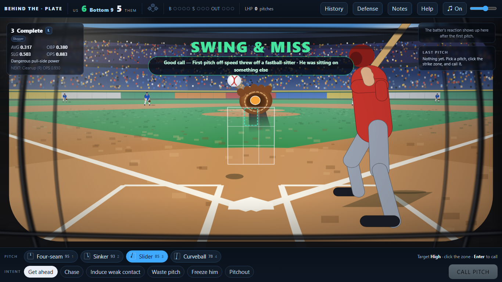
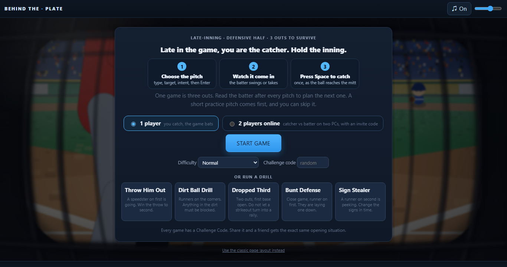
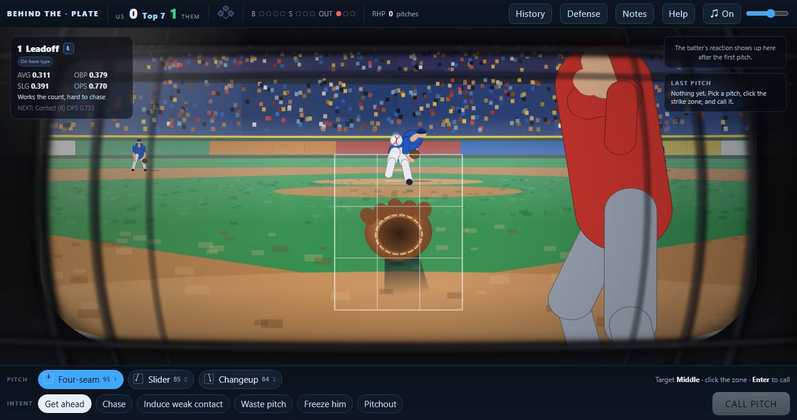
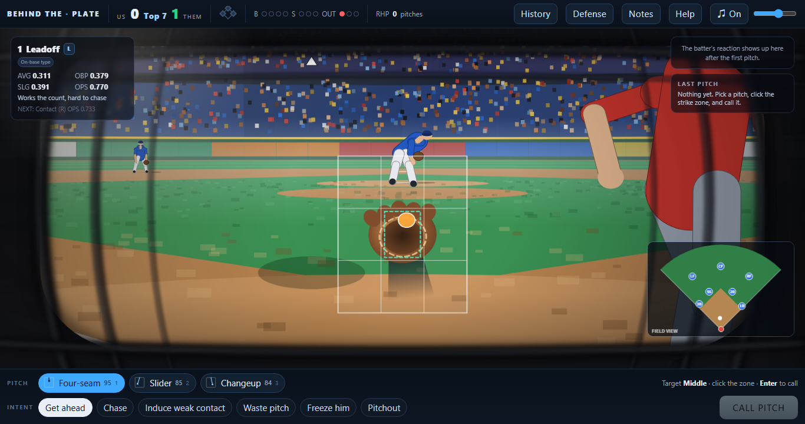
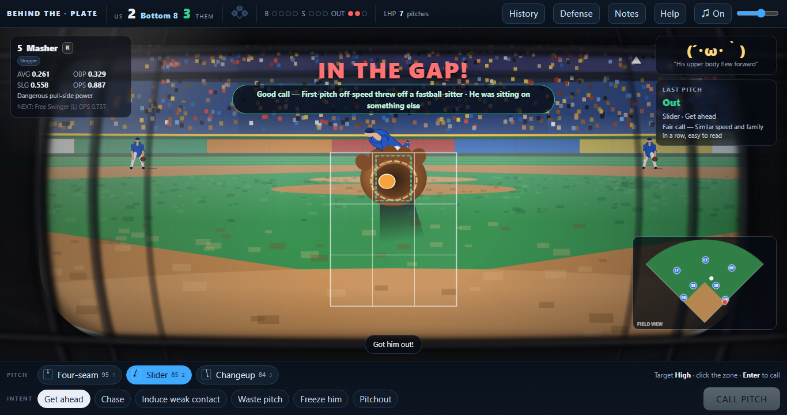
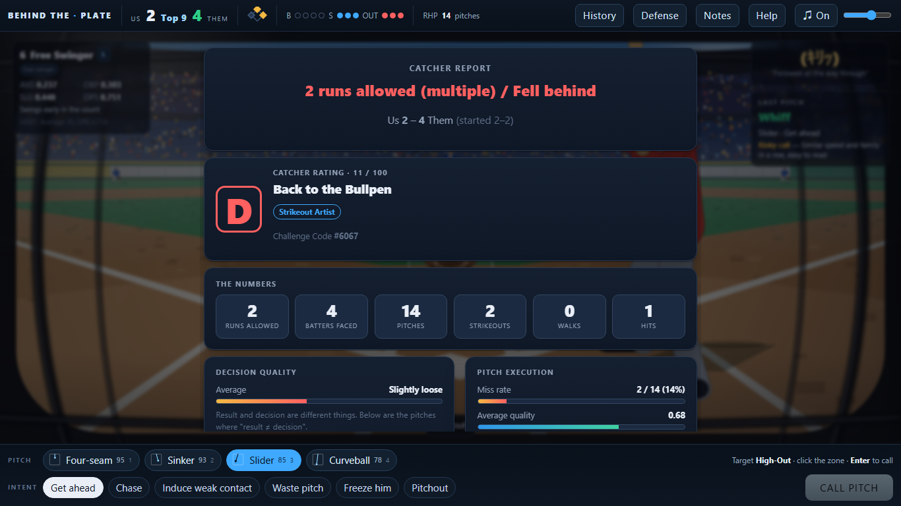

# Behind the Plate — A Catcher's Game

You are the catcher. It is the late innings, the lead is thin, and every pitch is your call.
Pick the **pitch**, the **location**, and the **intent**. Read the batter's face, the pitch history, and your defense.
Nobody tells you the right answer. Get three outs and hold the inning.

Pure Python, **zero dependencies** (standard library only). Play it in your browser (`webapp.py`) or in a terminal (`main.py`).



---

## Play it in the browser (no install)

The `docs/` folder is a browser-only build: the Python game runs inside your browser through Pyodide, so there is nothing to install or host. It is the same game code as `python webapp.py`. Turn on GitHub Pages for this repository (Settings, Pages, deploy from branch `main`, folder `/docs`) and open the page. The first load downloads Pyodide (about 10 MB). After changing the game, run `python build_pages.py` to rebuild `docs/`.

## Play it (30 seconds)

You only need Python 3.11 or newer (tested on 3.11 and 3.14). Nothing to install.

```bash
python webapp.py
```

Your browser opens at `http://127.0.0.1:8765` (use `--no-browser` to stop that, `--port N` to change the port; if the port is busy it picks the next free one). It is built for a laptop browser: the whole game fits on one screen, with no scrolling.

1. Press **START GAME** (or pick a **drill**).
2. Each pitch: **click a pitch type** (or press 1-9), **click where you want it in the strike zone** (your mitt moves there), pick an **intent**, and press **CALL PITCH** (or Enter).
3. Watch the pitcher wind up and the ball come in. When the play calls for it, you take over with a timing mini-game (framing, throwing out a runner, blocking, and more).
4. After each pitch you get the result, a one-line grade of your call, and the reason.
5. After the third out you get your **Catcher Rating** (S to D), badges, and a full review of your calling.

Keys: **1-9** pitch type, **arrows** move the target, **Enter** call, **Space** catch and timing games, **P** pause. Nothing can be skipped: Space only works in the moment it is for (the catch or the swing), and pressing it at any other time does nothing. A strip under the top bar always shows where you are (**1 Choose the pitch, 2 The pitch, 3 Catch it**), the one thing to do now, and the **call timer**.

**The call timer.** You have 15 seconds to choose a pitch (change or turn it off in **Settings**). The last five seconds turn red and tick. When time runs out, **your current pick is thrown**; if you have not picked anything, the standard call is used (Four-seam, middle, Get ahead). That rule is written on the screen. The timer stops while a help, settings or history panel is open, while the game is paused, during an animation and during the practice pitch, and it is separate from the Space-press timing of the catch.

**Practice.** The first time you play, one practice pitch walks you through the three steps with no timer; it is not counted and nothing is sent to the game. After a catch the guide says **SUCCESS**, **TOO EARLY** or **TOO LATE** and what to do next. You can replay it from the Help panel.

**Two players, two PCs (online, with an invite code).** On the start screen choose **2 players online**. One player creates a room (as the catcher or as the batter) and shares the six-character code (like `K7Q-H2M`); the other types it to join. Each player gets their own screen: the *catcher* picks the pitch, target and intent, presses Enter, and presses Space to catch; the *batter* waits, then presses **Space** the moment two rings overlap. Nothing about the call (pitch type, target, mitt) is sent to the batter's screen until the pitch has been thrown. The call timer starts only when both players are ready, and stops while the game is paused or someone is disconnected (the room pauses and says who dropped out; it resumes where it stood when they return). The batter can try **practice swings** in the lobby ("Press Space when the rings overlap").

- **A short match.** An online match is **one inning each**: the first half one of you catches and the other bats; then the sides switch (a six-second half-time card says so). Each half starts fresh (nobody on, nobody out, the same lineup, pitcher and fielders for both halves) and ends at 3 outs or 5 runs. After the second half a result card shows the runs per player (**win, lose or draw**, equal runs is a draw) and both of you pick **Rematch** or **Swap roles & rematch**; it starts when you pick the same one. Both screens always show the same outs, count, runners, runs and result.
- **Waiting for a pitch.** Before each pitch the batter may choose **Fastball**, **Off-speed** or **Either** (keys 1, 2, 3). The catcher is never told until the pitch is over. Guess right: a little harder contact and a slightly more forgiving window. Guess wrong: a slightly tighter window and a little less power, never an automatic miss (the swing still has to be off by a lot). Either: a very small edge. The game's own batter (one-player mode) also reads the last pitches: the same pitch type is timed (about 67% on time against 26-33% when you change types), and the same spot repeated gets hit harder than a changed spot.
- **Timing guide setting.** **Normal** rings are big and change colour near the moment; **Subtle** rings are thin and give no colour or word hints. Either player can change it in the lobby; doing so asks both players to agree again (READY is cleared), so the match only starts with a setting both accepted.
- **A recap after every pitch**, compact and out of the way (it shrinks a few seconds into the next call): aimed spot, where it crossed, the swing (a human batter's own milliseconds and a label; for the game's batter only the category it really judged), what the batter was waiting for (shown only after the pitch), the sequence (same pitch again, speed change), and the result. The **catch** has its own line (clean / barely / missed with the press timing), and the **call** is a separate matter. A **TIP** is kept apart from the facts and rests on them (for example, the same pitch three times in a row while he makes contact).
- **Practice.** One-player: the practice pitch can be skipped, and it ends by itself. Online: the lobby offers practice for both sides (the batter's practice swings; the catcher's call-and-catch practice), with no timer.
- **Easy batting: no cursor.** The page aims for the batter (a pitch down the middle is met squarely, an edge pitch less so, a ball off the plate hardly at all; low pitches become grounders and high ones fly balls). The batter only decides *when*. A press is judged **PERFECT** (within 40 ms of the ideal moment), **GOOD** (90 ms), **EARLY / LATE** (up to 200 ms: weak contact or a foul, and early pulls the ball while late goes the other way, left or right following the batter's hand), or a miss beyond that. No press is a take. One press per pitch: a held key or repeated presses do nothing.
- **The rings are tied to the real pitch.** They close on a fixed mark and overlap exactly when the bat should leave: the moment the ball (flown by the same physics on both screens) reaches the place where this pitch is best hit, minus the swing's travel time. A 95 mph fastball closes the rings sooner than a 78 mph curve. An inside pitch is met farther out in front of the plate, so its rings overlap earlier; an outside pitch is let come deeper, so later. The judgement uses the same moment, so the guide and the result always agree (checked in the automated test). The rings never show a pitch name or where it was aimed.
- **Fair over a slow connection.** The server stamps when each pitch starts; each PC measures how far its clock is from the server's and plays the pitch from that moment, so both screens show the same pitch. The batter's press is timed on the shared clock at the instant of the key press (the browser's event time stamp, not when the message reaches the server), so network delay does not cost them anything. Both screens then show the same result, runners and score, and the next call waits until both have finished watching.
- **How to host it.** Run `python webapp.py --host 0.0.0.0` on one PC, and both players open `http://<that PC's address>:8765` (the same address, on the same network, or through a tunnel you trust). The traffic is plain HTTP and the room code is the only key, so use a network you trust. The browser-only build on GitHub Pages has no server, so online play is available only when you run the Python server; one-player mode works everywhere. Honest limits: a batter who inspects the network traffic could read the pitch type shortly before the release (the page needs it to fly the ball), and there is no account system or matchmaking.
The old page-style layout is still available at `/classic`. Terminal version: `python main.py` (Enter = pitch, `d` = defense, `m` = note a read, `w` = intentional walk, `p` = pitching change, `q` = quit).

Run the tests: `python tests.py` (231 tests, including 1000 simulated games). Developers: start the server with `BTP_DEV=1` to reload the files in `web/` on every refresh and to get the screenshot helpers in `web/dev_tools.js`.



---

## Seen through the mask

The main screen is a first-person view from a crouch behind the plate, in perspective, looking out through a catcher's mask. About 80% of the screen is the stadium.

- **Your eyes, behind the plate.** The camera is at a catcher's eye height, a few metres back, with a long lens, so the pitcher fills the middle of the picture and you can follow his whole body and the release.
- **The batter is where a batter stands.** He is in his real box, right beside you. His shoulder, arm, helmet and bat come into view, and the bat can cross in front of the pitcher while he waits and when he swings. A right-handed batter fills the left side, a left-handed batter the right.
- **A narrow opening.** The mask's padding and bars come in from all four sides, soft and out of focus. They stay toward the edges, so the pitcher, the release point and the line of the pitch stay clear.
- **A big, comic-book delivery, right- or left-handed.** He waits sideways, chest turned away from home, with a slow sway. The front knee goes up high and swings toward third base, the hands rise, the upper body winds back further than the hips, and he freezes for a beat. Then a long stride with the chest still closed, and everything turns in order, fast: hips, chest, shoulders, then the elbow leads the arm to the release. A big follow-through folds him over the front leg while the back leg swings through. Slow tame, sudden snap, big sweep. The motion is deliberately exaggerated and original, not a reconstruction of any real pitcher. A left-hander is the same motion mirrored, so the stride foot, arm and release point stay consistent.
- **The ball obeys physics.** It leaves the pitcher's hand at the release point and flies under gravity, air drag and the Magnus force from spin (`0.5 * rho * A * Cl * v^2` along `spin x velocity`, with `Cl` from the spin factor so spin rate matters). The game decides where the pitch ends up, and the code solves for the throw that gets there, so a four-seam, a curveball and a slider all arrive at the spot you can see but on visibly different paths. The speeds and spin rates are placeholders, not measurements of any real player. Playback uses the clock, not the frame count, so the speed never depends on your frame rate (the flight is stretched by one fixed factor so the eye can follow it).
- **It gets big fast.** The ball keeps its real size: tiny far away, then rapidly bigger because of the perspective, with a short afterimage. It meets your mitt at a catch point behind the plate, with a sharp pop, a short jolt of the picture and a recoil of the mitt, all synthesized in the browser.
- **Catch it with one press.** The mitt goes to the ball by itself; you only press Space at the moment the ball reaches it (one press per pitch, so holding or mashing does nothing). Timing alone is judged: clean, barely caught, or missed (too early or too late; a passed ball if runners are on). A ring closes on the mitt and turns gold at the right moment: always shown for your first few catches, then hidden on Expert. A clean catch can steal a strike on a ball just off the edge. Your call and your catch are graded separately.
- **Read the batter after every pitch.** A panel at the top shows his mood as a Japanese emoticon (kaomoji) with a short English label (Confident, Nervous, Surprised, Frustrated...), where the ball and his bat crossed the zone, whether he was early, on time or late, and facts from his last swings (only what was actually seen, never a claim about his plan). It shrinks while the next pitch is thrown.
- **Click the zone.** The 3x3 strike zone is overlaid on the 3D scene. Click a cell to call the location. After the pitch it shows where you asked (dashed) and where it really went (orange dot).
- **Short result, then your grade.** "STRIKE", "SWING & MISS", "FALLS IN!", then a line like *Good call: first-pitch off-speed threw off a fastball-sitter*.
- **Balls in play are replayed** with the fielder running it down, the throw and the runners. The camera then **rises to a slightly high oblique view** of the infield and the needed outfield, follows the ball, the fielders and every runner, shows **OUT / SAFE** at the base where it happens and **RUN n** at home, and returns to the catcher's view. Players are drawn as very simple legless characters (big round head, small body, cap and glove show the role).
- **No scrolling.** Score, count, outs and runners are in the top bar; pitch buttons are at the bottom; the batter's card is on the left; history, defense, notes and help open as side panels over the picture.





### Music

One original trumpet-and-drums loop (synthesized in the browser, no audio files). The catch pop, the swing and the bat crack use the same audio player and follow the same mute and volume. It never restarts while you play: the page does not reload between pitches, there is a single audio player, and the loop continues from the last bar back to the first. The top bar has a mute button and a volume slider, and both are remembered.

---

## What makes it different

**It never shows you an answer key.** The game tracks a hidden score for the quality of every call you make, but it never shows that number. While you play you read the batter's reaction (a face plus a line of text, and sometimes a face that lies), the history of what you already showed him, his handedness and stats, and your defense.
After each pitch you do get a plain-language grade (good, fair or risky) and the main reason, so you can learn as you go; **Expert** mode turns that off and hides the spray chart.
After the game it grades your decisions separately from the results, so you can see which calls were smart but unlucky and which were lucky but sloppy.

**You play the catcher, not just the caller.** Besides calling pitches you:

| Moment | Your job |
|---|---|
| Borderline pitch | **Frame** it: stop the moving line in the green band to steal a strike |
| Runner goes | **Throw down** to second: transfer, mash, throw |
| Ball in the dirt | **Block** it: get your body to the right side, then drop |
| Dropped third strike | Block it, then throw to first |
| Bunt | Charge, grab, and throw |
| Runner on second peeks at your signs | **Change the signs** in time |
| Every caught pitch | Return it to the pitcher on a steady **tempo** (a good rhythm keeps him sharp) |

These rhythm games never decide a play on their own. They only nudge the odds (at most ±0.25), the same way a great throw can still be late and a bad one can still get the runner.

**Real baseball texture.** Batter types (power, contact, patient, free swinger), a hot zone and a weak zone for each hitter, sequencing (show low, then climb the ladder), pitcher fatigue, defensive shifts and swappable fielders, sacrifice bunts, hit-and-runs, pitchouts, steals, dropped third strikes, and a bullpen.

---

## Added during the hackathon

See [the next section](#built-on-a-pre-existing-base-be-upfront-about-this) for what existed before. These features are new:

- **The catcher's-eye 3D view** (`stadium.py`, `web/`, `api.py`): a one-screen stadium page seen through the mask, a clickable strike zone, a mitt that follows your target, a full-body pitching motion for either hand, a ball flown by gravity, drag and spin (Magnus force), the batter and his bat close beside you, a one-line grade and reason after every pitch, and a high oblique play view for balls in play. The page talks to the same Python game rules through a small JSON API, so it never reloads.
- **Timer, step guide, practice and online two-player mode** (`rooms.py`, `swing.py`, `judge.prepare_pitch`, the `/room/*` routes, `/pitch2p` and `/swing` in `webapp.py`, `web/js_online.js`, `web/js_duel.js`): the call timer with its on-screen rule, pause, the three-step guide, one practice pitch, and an invite-code catcher-vs-batter game on two PCs. The server is the referee: it keeps the one real game of the room, hides the call until the pitch is thrown, stamps the pitch's start time, judges the batter's swing from the shared-clock time of the key press with the same rules and numbers the page draws (checked in `tests.py`), then hands it to the normal fielding and baserunning rules, so an online result is as consistent as a one-player one.
- **Music that does not restart**: one audio player independent of the screen, a seamless loop, mute and volume that are remembered (`bgm_js.py`).
- **Play Viewer**: an animated replay of every ball in play (flight, the fielder's run, the throw, and the baserunners), drawn from the same result the game already decided (`playview.py`; the OUT / RUN labels are checked against the game's out count and runs in `tests.py`). It never changes the outcome and uses no game randomness.
- **Catcher Rating (S, A, B, C, D)** with a title and badges (Shutdown, Strikeout Artist, Pickpocket, Mind Games, Cannon Arm, Hard Luck), computed from runs allowed, decision quality, strikeouts, framing, and holding the lead.
- **Drills** on the start screen: Throw Him Out, Dirt Ball Drill, Dropped Third, Bunt Defense, Sign Stealer. Each one drops you into a situation built for that skill.
- **Challenge Codes**: every game gets a short code. Type a friend's code on the start screen and you get the exact same opening situation. "Replay this situation" on the report screen reuses yours.
- **Difficulty** from the start screen: Beginner (hints), Normal, Expert (no spray chart).
- **Judge-proofing**: the web server is threaded with a request lock and idle timeouts (browsers open speculative connections that used to be able to freeze a single-threaded server), unexpected errors show a recovery page instead of a dead tab, bad or hand-typed form values are ignored, the port auto-falls back, and the browser opens by itself.
- **A fuzz pass** that drove 270 web games (120 through the classic forms, 150 through the JSON API) with junk input (bad QTE answers, invalid forms, random actions). It found and fixed one real crash (an invalid note value broke the post-game review). The 190 unit tests now cover that case.
- **Full English version** of the game: UI text, hints, analysis, replay viewer, stats, lineups, and tests.

---

## Built on a pre-existing base (be upfront about this)

This game grew from a Python catcher/pitch-calling simulator I wrote **before** the hackathon as a personal project (Japanese UI). The Ensign Build organizers confirmed that rebuilding on top of it was fine, and I am telling you plainly so the judges can weigh it:

- **Before the hackathon (the base snapshot):** the engine, the batter/pitcher/defense models, the judging chain, the CLI and web versions, the six rhythm mini-games, the music, and the original test suite, all in Japanese. This is the first commit of this repository (`Base snapshot: pre-existing project (before Ensign Build)`), created at the start of the event so the history shows exactly what came after.
- **During the hackathon (every commit after that):** the complete English conversion and the items in the list above.

Run `git log` to see the split.

### AI disclosure

I used **Claude Code (Anthropic's Claude)** as a coding assistant during the hackathon, for the English translation and the new features listed above, and I used it earlier in the original project. I directed the work, tested it, and made the design decisions; the code is mine to explain and maintain. Commits that Claude helped write carry a `Co-Authored-By` line.

The background music is synthesized in the browser with the Web Audio API (oscillators and noise; there are no audio files). The ♪ button in the top right turns it off.

---

## Why a catcher game

I played baseball for ten years, mostly as a catcher. A catcher decides on every pitch with incomplete information: you glance at the batter's stance, feel the runner leaning, and build the next pitch in your head while returning the ball to set the pitcher's rhythm.
I wanted that feeling in a game: **deciding by your own read, with the answer hidden**, not pressing the button with the best win rate.

---

## Design notes

1. **One place judges a pitch.** `engine.resolve_one_pitch()` is the only entry point. The terminal version and the web version both call it, so the rules are never written twice; only the display differs.
2. **The hidden number stays hidden.** `decision_quality` (-1 to +1) is computed for every pitch but is never sent to the browser or shown. During play you only see a plain-language grade and the main reason (off in Expert mode); the full breakdown comes after three outs. A test checks that the API never carries the number.
3. **Rhythm games shift probabilities, never outcomes.** A QTE moves a success chance by at most ±0.25.
4. **Reproducible.** The engine takes a `random.Random(seed)` end to end, so a Challenge Code (or `--seed N`) reproduces the opening scene and the batter's reactions.
5. **Swappable data.** Add a pitch by adding one entry to `pitch_data.py`. Swap the opposing lineup with `--lineup team.json` (JSON or CSV), or try `--mlb-demo` for a sample lineup of real players (`--mlb-live` tries the MLB Stats API and falls back to sample data on any failure). Real data goes through `mlb_data_adapter.py` so an API format change touches one file.



### Project layout

```
engine.py          the single entry point that judges a pitch and advances the game (CLI and web)
match_state.py     MatchState (the situation) and the random late-inning scene generator
judge.py           the judging chain: execution -> target -> setup -> timing -> batted ball
strategy.py        intents, setups, decision quality, post-game analysis, Catcher Rating
pitcher.py         Pitcher and execute_pitch (called pitch vs actual pitch; misses drift)
batter.py          Batter (public: hand/OPS/type; hidden: weak pitch, guess habits)
lineup.py          the opposing lineup, batting order, JSON/CSV loading
pitch_data.py      pitch data (add a row, get a pitch)
batted_ball.py     fair batted-ball generation          baserunning.py   advancing runners
fielders.py        fielders and positional fit          defense.py       alignments and shifts
fielding.py        batted ball + alignment -> out/hit    reaction.py      the batter's face and line
opponent.py        the opposing bench (bunts, hit-and-run)
qte.py             the catcher's rhythm mini-games (terminal)
main.py            terminal version                      webapp.py        web version (http.server)
playview.py        the Play Viewer (classic page) and the replay script the 3D page also uses
swing.py           a human batter's swing (two-player mode): timing (+ where the ball was) -> miss / foul / batted ball
rooms.py           online rooms: invite codes, who is connected, the pause, the pitch clock (the request code is in webapp.py)
stadium.py         the 3D catcher's-eye page; its canvas code is in web/ (camera and ball physics, stadium, the pitcher's delivery, players, game loop)
api.py             the JSON the 3D page reads (state, evaluation text); never the hidden score
bgm_js.py          the background music (one player, seamless loop)
tests.py           182 unittest tests incl. a 1000-game stress test
```

## Tech

Python 3 standard library only. Web UI: server-rendered HTML forms plus a small amount of JavaScript for the timing mini-games (with JS off, a button still moves the game along). Music: Web Audio API. Tests: `unittest`, with GitHub Actions CI.

## License

MIT. See [LICENSE](LICENSE).
