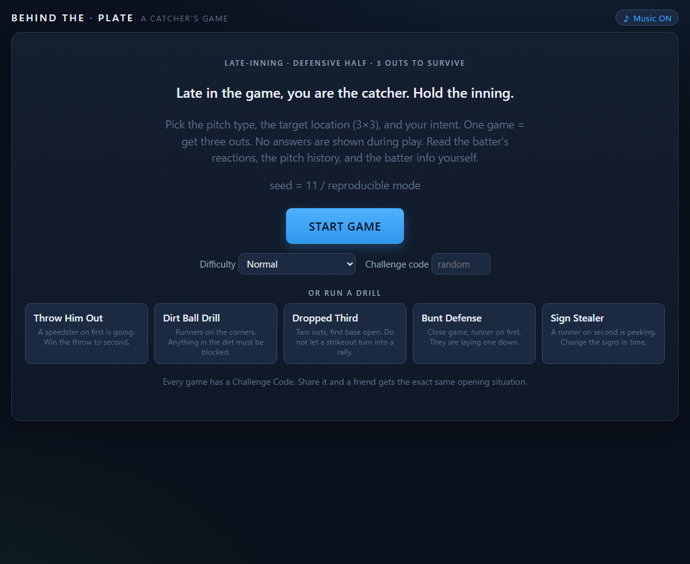
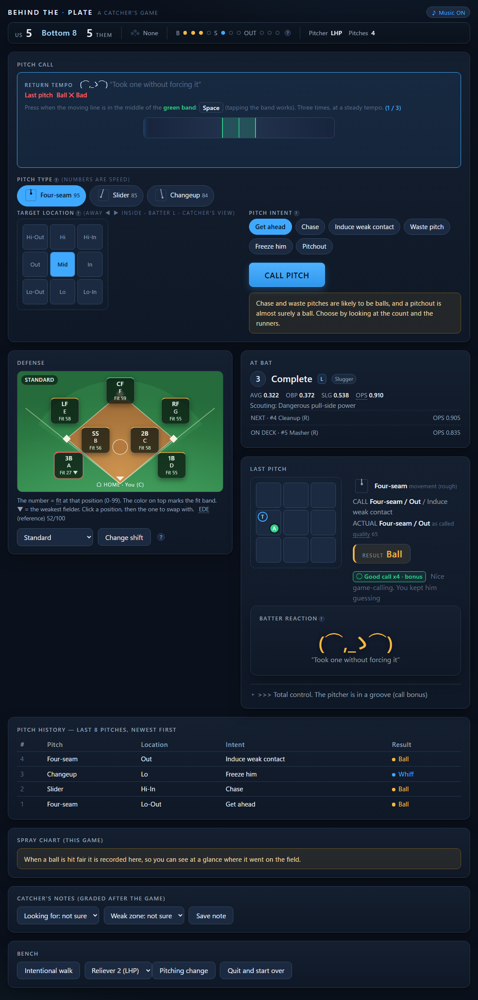
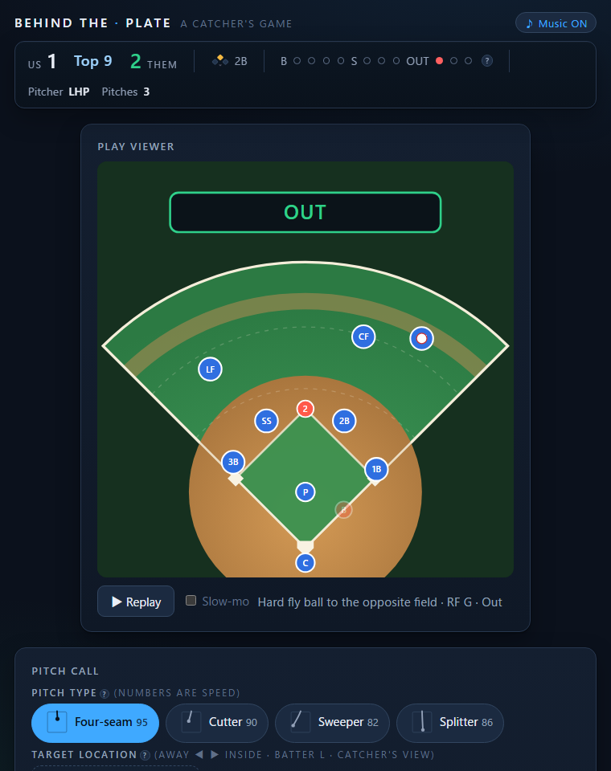
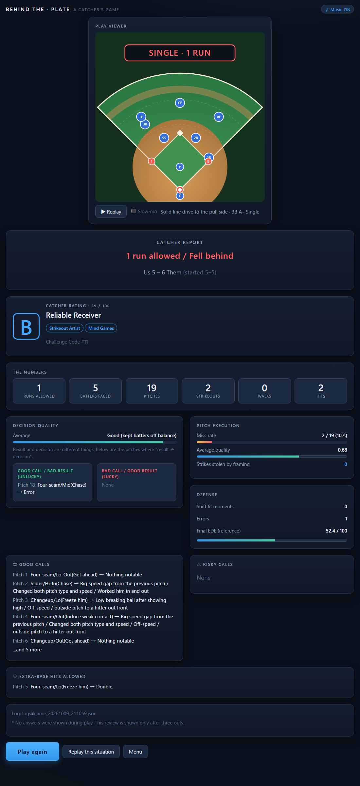

# Behind the Plate — A Catcher's Game

You are the catcher. It is the late innings, the lead is thin, and every pitch is your call.
Pick the **pitch**, the **location**, and the **intent**. Read the batter's face, the pitch history, and your defense.
Nobody tells you the right answer. Get three outs and hold the inning.

Pure Python, **zero dependencies** (standard library only). Play it in your browser (`webapp.py`) or in a terminal (`main.py`).



---

## Play it (30 seconds)

You only need Python 3.11 or newer (tested on 3.11 and 3.14).

```bash
python webapp.py
```

Your browser opens at `http://127.0.0.1:8765` (use `--no-browser` to stop that, `--port N` to change the port; if the port is busy it picks the next free one).

1. Press **START GAME** (or pick a **drill**, see below).
2. Warm up with the six short rhythm drills, or skip them.
3. Each pitch: choose a pitch type, a location on the 3×3 grid, and an intent, then press **CALL PITCH**.
4. When the play calls for it, you take over with a timing mini-game (framing, throwing out a runner, blocking, and more).
5. After the third out you get your **Catcher Rating** (S to D), badges, and a full review of your calling.

Terminal version: `python main.py` (Enter = pitch, `d` = defense, `m` = note a read, `w` = intentional walk, `p` = pitching change, `q` = quit).

Run the tests: `python tests.py` (172 tests, including 1000 simulated games).



### Watch the play like a board game

Every ball in play is replayed on a little field, "yakyuban" style: the ball arcs or bounces, the fielder who makes the play runs to it, the throw goes to the right base, and every runner moves. Hit **Replay** or tick **Slow-mo** to watch it again.



---

## What makes it different

**It hides the answer.** The game tracks a hidden "decision quality" for every call you make, but it never shows it while you play.
You read the batter's reaction (a face plus a line of text, and sometimes a face that lies), the history of what you already showed him, his handedness and stats, and your defense.
After the game it grades your decisions separately from the results, so you can see which calls were smart but unlucky and which were lucky but sloppy.

**You play the catcher, not just the caller.** Besides calling pitches you:

| Moment | Your job |
|---|---|
| Borderline pitch | **Frame** it: stop the moving line in the green band to steal a strike |
| Runner goes | **Throw down** to second: transfer, mash, throw |
| Ball in the dirt | **Block** it: get your body to the right side, then drop |
| Dropped third strike | Block it, then throw to first |
| Bunt | Charge, grab, and throw |
| Runner on second peeks at your signs | **Change the signs** in time |
| Every caught pitch | Return it to the pitcher on a steady **tempo** (a good rhythm keeps him sharp) |

These rhythm games never decide a play on their own. They only nudge the odds (at most ±0.25), the same way a great throw can still be late and a bad one can still get the runner.

**Real baseball texture.** Batter types (power, contact, patient, free swinger), a hot zone and a weak zone for each hitter, sequencing (show low, then climb the ladder), pitcher fatigue, defensive shifts and swappable fielders, sacrifice bunts, hit-and-runs, pitchouts, steals, dropped third strikes, and a bullpen.

---

## Added during the hackathon

See [the next section](#built-on-a-pre-existing-base-be-upfront-about-this) for what existed before. These features are new:

- **Play Viewer**: an animated replay of every ball in play (flight, the fielder's run, the throw, and the baserunners), drawn from the same result the game already decided (`playview.py`). It never changes the outcome and uses no game randomness.
- **Catcher Rating (S, A, B, C, D)** with a title and badges (Shutdown, Strikeout Artist, Pickpocket, Mind Games, Cannon Arm, Hard Luck), computed from runs allowed, decision quality, strikeouts, framing, and holding the lead.
- **Drills** on the start screen: Throw Him Out, Dirt Ball Drill, Dropped Third, Bunt Defense, Sign Stealer. Each one drops you into a situation built for that skill.
- **Challenge Codes**: every game gets a short code. Type a friend's code on the start screen and you get the exact same opening situation. "Replay this situation" on the report screen reuses yours.
- **Difficulty** from the start screen: Beginner (hints), Normal, Expert (no spray chart).
- **Judge-proofing**: the web server is threaded with a request lock and idle timeouts (browsers open speculative connections that used to be able to freeze a single-threaded server), unexpected errors show a recovery page instead of a dead tab, bad or hand-typed form values are ignored, the port auto-falls back, and the browser opens by itself.
- **A fuzz pass** that drove 120 web games with junk input (bad QTE answers, invalid forms, random actions). It found and fixed one real crash (an invalid note value broke the post-game review). The 172 unit tests now cover that case.
- **Full English version** of the game: UI text, hints, analysis, replay viewer, stats, lineups, and tests.

---

## Built on a pre-existing base (be upfront about this)

This game grew from a Python catcher/pitch-calling simulator I wrote **before** the hackathon as a personal project (Japanese UI). The Ensign Build organizers confirmed that rebuilding on top of it was fine, and I am telling you plainly so the judges can weigh it:

- **Before the hackathon (the base snapshot):** the engine, the batter/pitcher/defense models, the judging chain, the CLI and web versions, the six rhythm mini-games, the music, and the original test suite, all in Japanese. This is the first commit of this repository (`Base snapshot: pre-existing project (before Ensign Build)`), created at the start of the event so the history shows exactly what came after.
- **During the hackathon (every commit after that):** the complete English conversion and the items in the list above.

Run `git log` to see the split.

### AI disclosure

I used **Claude Code (Anthropic's Claude)** as a coding assistant during the hackathon, for the English translation and the new features listed above, and I used it earlier in the original project. I directed the work, tested it, and made the design decisions; the code is mine to explain and maintain. Commits that Claude helped write carry a `Co-Authored-By` line.

The background music is synthesized in the browser with the Web Audio API (oscillators and noise; there are no audio files). The ♪ button in the top right turns it off.

---

## Why a catcher game

I played baseball for ten years, mostly as a catcher. A catcher decides on every pitch with incomplete information: you glance at the batter's stance, feel the runner leaning, and build the next pitch in your head while returning the ball to set the pitcher's rhythm.
I wanted that feeling in a game: **deciding by your own read, with the answer hidden**, not pressing the button with the best win rate.

---

## Design notes

1. **One place judges a pitch.** `engine.resolve_one_pitch()` is the only entry point. The terminal version and the web version both call it, so the rules are never written twice; only the display differs.
2. **Hidden state stays hidden.** `decision_quality` (-1 to +1) is computed for every pitch and shown only after three outs. A test checks that it never appears during play.
3. **Rhythm games shift probabilities, never outcomes.** A QTE moves a success chance by at most ±0.25.
4. **Reproducible.** The engine takes a `random.Random(seed)` end to end, so a Challenge Code (or `--seed N`) reproduces the opening scene and the batter's reactions.
5. **Swappable data.** Add a pitch by adding one entry to `pitch_data.py`. Swap the opposing lineup with `--lineup team.json` (JSON or CSV), or try `--mlb-demo` for a sample lineup of real players (`--mlb-live` tries the MLB Stats API and falls back to sample data on any failure). Real data goes through `mlb_data_adapter.py` so an API format change touches one file.



### Project layout

```
engine.py          the single entry point that judges a pitch and advances the game (CLI and web)
match_state.py     MatchState (the situation) and the random late-inning scene generator
judge.py           the judging chain: execution -> target -> setup -> timing -> batted ball
strategy.py        intents, setups, decision quality, post-game analysis, Catcher Rating
pitcher.py         Pitcher and execute_pitch (called pitch vs actual pitch; misses drift)
batter.py          Batter (public: hand/OPS/type; hidden: weak pitch, guess habits)
lineup.py          the opposing lineup, batting order, JSON/CSV loading
pitch_data.py      pitch data (add a row, get a pitch)
batted_ball.py     fair batted-ball generation          baserunning.py   advancing runners
fielders.py        fielders and positional fit          defense.py       alignments and shifts
fielding.py        batted ball + alignment -> out/hit    reaction.py      the batter's face and line
opponent.py        the opposing bench (bunts, hit-and-run)
qte.py             the catcher's rhythm mini-games (terminal)
main.py            terminal version                      webapp.py        web version (http.server)
playview.py        the Play Viewer: builds a timeline of the ball, fielders and runners and plays it on an SVG field
tests.py           172 unittest tests incl. a 1000-game stress test
```

## Tech

Python 3 standard library only. Web UI: server-rendered HTML forms plus a small amount of JavaScript for the timing mini-games (with JS off, a button still moves the game along). Music: Web Audio API. Tests: `unittest`, with GitHub Actions CI.

## License

MIT. See [LICENSE](LICENSE).
